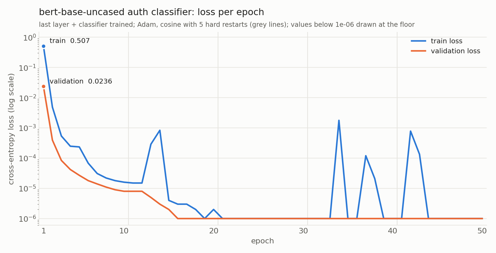

# sam test

A scratch project.

Manage Python dependencies and the project environment with [uv](https://docs.astral.sh/uv/).

Install uv using the [installation guide](https://docs.astral.sh/uv/getting-started/installation/), then set up the environment:

```sh
uv sync --locked
```

Run Python in the project environment:

```sh
uv run python
```

Add dependencies with `uv add <package>` or development dependencies with `uv add --dev <package>`.
Commit both `pyproject.toml` and `uv.lock` when dependencies change. The `.venv/` directory is ignored by Git.

## Data

`auth_data/` holds a synthetic dataset of 10,000 agent/customer call transcripts,
chunked for `bert-base-uncased` and labelled `ID_AUTH` / `OTHER_AUTH` / `NO_AUTH`
with train / validation / test splits. See [auth_data/README.md](data/README.md) for
the schema, labelling rules, and how to regenerate it.

## Training

`auth_train/` fine-tunes the local `bert-base-uncased` on that data and saves the
checkpoint to `models/`. Run `./auth_train/run.sh`; see
[auth_train/README.md](auth_train/README.md) for the full recipe.

| Setting | Value |
|---------|-------|
| Model | `bert-base-uncased` (12 layers), defined in [auth_train/model.py](auth_train/model.py) |
| Trainable | last encoder layer + pooler + classifier (7.68 M of 109.5 M parameters); embeddings and layers 1–11 frozen |
| Embeddings | frozen-layer hidden states precomputed once and cached before batched training |
| Optimizer / loss | Adam (peak lr 3e-5) / cross-entropy |
| LR schedule | cosine with hard restarts, 5 cycles over 50 epochs, 5% warmup |
| Gradient clipping | global norm 1.0 |
| Epochs / batch | 50 / 32 |
| Hardware | Apple Silicon GPU via PyTorch MPS, 831 s total (~17 s per epoch) |

### Results

Per-epoch train and validation loss are recorded in
[auth_train/results/epoch_metrics.csv](auth_train/results/epoch_metrics.csv)
(also `.json`, plus `train.log`, `training_args.json`, `summary.json`).

| Epoch | Train loss | Val loss | Val accuracy | Val macro-F1 |
|------:|-----------:|---------:|-------------:|-------------:|
| 1 | 0.5075 | 0.0236 | 0.9940 | 0.9952 |
| 2 | 0.0049 | 0.0004 | 1.0000 | 1.0000 |
| 3 | 0.0005 | 0.0001 | 1.0000 | 1.0000 |
| 10 | 1.6e-5 | 8e-6 | 1.0000 | 1.0000 |
| 20 | 2e-6 | 1e-6 | 1.0000 | 1.0000 |
| 33 (best) | <1e-6 | 1.4e-10 | 1.0000 | 1.0000 |
| 50 | <1e-6 | <1e-6 | 1.0000 | 1.0000 |



The chart is produced by `uv run python auth_train/plot_losses.py` from the
recorded metrics. Loss is on a log scale; values below 1e-6 (the recording
precision) are drawn at the floor. The small train-loss bumps after epochs 10,
30 and 40 are the cosine hard restarts kicking the learning rate back up.

Held-out test split, best checkpoint, full model run end to end on raw text
([auth_train/results/test_metrics.json](auth_train/results/test_metrics.json)):

| Class | Precision | Recall | F1 | Support |
|-------|----------:|-------:|---:|--------:|
| ID_AUTH | 1.000 | 1.000 | 1.000 | 800 |
| NO_AUTH | 1.000 | 1.000 | 1.000 | 1,539 |
| OTHER_AUTH | 1.000 | 1.000 | 1.000 | 200 |
| **overall** | **accuracy 1.000** | | **macro-F1 1.000** | 2,539 |

Zero misclassified chunks; test loss 2.8e-10. The synthetic data is templated,
so the task saturates within two epochs. The 50-epoch recipe is in place for
harder or real transcripts.

Checkpoints: `models/bert-auth-classifier/best/` (epoch 33) and `final/`
(epoch 50), loadable with `BertForSequenceClassification.from_pretrained`.

### Monitoring GPU usage

[macmon](https://github.com/vladkens/macmon) is the Homebrew package for
watching Apple Silicon GPU, CPU and memory usage while training runs (no sudo
needed):

```bash
brew install macmon   # already installed here (0.9.0)
macmon                # live TUI; run it in a second terminal during ./auth_train/run.sh
```

## Call classification and summarization data

`class_data/` holds 100,000 noisier synthetic health-plan call transcripts in the
same `agent:` / `customer:` format, labelled for multi-class and multi-label
classification across seven call-center buckets (Billing, Claim Status,
Coverage, Complaints, PriorAuth, NEMT, Technical Issue) and paired with a
reference summary for BART. Intended for a RoBERTa classifier and a BART
summarizer POC. See [class_data/README.md](class_data/README.md).

## Call classifier training (RoBERTa, multi-label)

`class_train/` holds the fine-tuning workflow for a `roberta-base` multi-label
classifier over the seven call-center buckets in `class_data/`. It follows the
same schema as the BERT run: frozen embeddings and layers 1–11 precomputed once,
trainable last layer + classification head, Adam, cosine with hard restarts,
gradient clipping, per-epoch train/validation loss. The loss is
`BCEWithLogitsLoss` with one logit per bucket. The local RoBERTa copy is used;
nothing is downloaded.

The workflow is set up and smoke-tested but **has not been run on the full
data yet**, so there are no findings to report. Run it with:

```bash
./class_train/run.sh                 # full 100k calls, 20 epochs
LIMIT=20000 ./class_train/run.sh     # smaller, faster run
```

Results land in `class_results/` (per-epoch metrics, test metrics at 0.5 and
tuned thresholds, per-label report, primary-label confusion matrix, loss chart)
and checkpoints in `models/roberta-call-classifier/`. Full CLI options are in
[class_train/README.md](class_train/README.md).

### GPU utilization during training

Measured with `macmon pipe -i 1000` on this machine (Apple M5 Max, 48 GB
unified memory) while the RoBERTa call-classifier workflow was running on the
full 100k-call data:

| Sample | GPU clock | GPU busy | GPU power | P-core CPU | RAM | Swap |
|-------:|----------:|---------:|----------:|-----------:|----:|-----:|
| 1 | 1615 MHz | 96% | 61.2 W | 5% | 30.5 GB | 0 |
| 2 | 1617 MHz | 99% | 64.0 W | 3% | 30.4 GB | 0 |
| 3 | 1615 MHz | 95% | 61.2 W | 6% | 30.4 GB | 0 |
| 4 | 1616 MHz | 99% | 63.5 W | 3% | 30.2 GB | 0 |
| 5 | 1617 MHz | 97% | 63.6 W | 3% | 30.2 GB | 0 |

**What is being pushed through the GPU**

| | Value |
|---|---|
| GPU | Apple M5 Max, 40 GPU cores, Metal 4, 48 GB unified memory (PyTorch MPS working-set limit 40.2 GB) |
| Model | `roberta-base`: 124.65 M parameters (499 MB fp32); 116.97 M frozen (embeddings + layers 1–11, 468 MB), 7.68 M trainable (layer 12 + head, 30.7 MB) |
| Trainable-state footprint | weights 30.7 MB + gradients 30.7 MB + Adam moments 61.5 MB, about 123 MB resident on the GPU during training |
| Hidden-state cache | float16, 1,536 bytes per token, 20.7 M tokens = 32 GB on disk, read per batch with `os.pread` (not memory-mapped) |

Batch sizes, as loaded by the scripts (hidden width 768, 12 heads, FFN width 3072, all fp32 on device):

| Stage | Batch | Tokens per batch | Hidden-state tensor | Attention scores (12 heads) | FFN activations |
|-------|------:|-----------------:|--------------------:|----------------------------:|----------------:|
| `precompute_embeddings.py`, typical batch | 32 calls × ~207 tokens | 6,624 | 20.3 MB | 65.8 MB | 81.4 MB |
| `precompute_embeddings.py`, longest batch | 32 calls × 488 tokens | 15,616 | 48.0 MB | 365.8 MB | 191.9 MB |
| `train.py` training step, typical bucket | 32 calls × 256 tokens (calls of 193–256 tokens) | 8,192 | 25.2 MB in (~10 MB read from the fp16 cache) | 100.7 MB | 100.7 MB |
| `train.py` training step, longest bucket | 16 calls × 512 tokens (token budget 8,192) | 8,192 | 25.2 MB | 201.3 MB | 100.7 MB |
| `train.py` validation batch | 64 calls × ~207 tokens | 13,248 | 40.7 MB | 131.6 MB | 162.8 MB |

Each precompute batch runs those tensors through 11 encoder layers back to
back, and each training step runs one layer forward and backward on the same
shapes, so every kernel launch carries thousands of tokens of dense matmul
work (6.6k–15.6k tokens × 768 × 3072 per FFN) rather than a handful. The
weights (499 MB) and the per-batch activations (a few hundred MB at most) fit
in a small fraction of the 40 GB working set, so nothing is paged and the
40 cores stay busy on compute rather than waiting on memory.

The GPU sits at 95–99% busy at its top clock and the CPU is nearly idle: the
workload is GPU-bound, which is what a fine-tuning loop should look like. Five
choices in the workflow produce that:

1. **Everything runs on the Metal backend.** `pick_device()` selects
   `torch.device("mps")` on Apple Silicon, so the model, every batch and the
   loss live on the GPU. Only the memmap reads happen on the CPU.
2. **The frozen stack is run once, at full batch width.** `precompute_embeddings.py`
   pushes embeddings + layers 1–11 through the GPU in length-sorted batches of
   32 calls under `torch.no_grad()`. Sorting by length means almost no padding,
   so every matmul is dense useful work rather than masked filler.
3. **Training steps touch only the trainable part.** With the frozen outputs
   cached, each step is one encoder layer + the head, forward and backward. The
   GPU never recomputes the 11 frozen layers, so steps are short and the
   optimizer/scheduler overhead between kernels stays small.
4. **Fixed-shape, length-bucketed batching keeps the GPU fed without growing
   memory.** `CachedHiddenSplit.make_batches()` rounds each call's length up
   to a multiple of `--length-bucket` (64) tokens and gives every bucket a
   constant row count `min(32, --max-tokens-per-batch // padded_len)`, so an
   epoch uses only seven tensor shapes: 32×128, 32×192, 32×256, 25×320,
   21×384, 18×448 and 16×512. Padding is small (at most 63 tokens per call),
   long-call batches shrink instead of allocating 366 MB of attention scores
   per layer, and partial batches are filled with masked duplicate rows so the
   shape never changes. The float16 cache is cast to float32 one batch at a
   time while the previous batch's kernels drain.
5. **No host round-trips inside the step.** Loss, gradient clipping, the Adam
   update and the cosine-restart scheduler all operate on device tensors; the
   only `.item()` calls are the running loss and the gradient norm, once per
   batch.

Memory stays flat because of two details that were both learned the hard way
on this run, each of which produced `RuntimeError: MPS backend out of memory
(MPS allocated: 6 GiB, other allocations: 57 GiB, max allowed: 63.65 GiB)`
partway through the first epoch:

* **The cache is read with positional reads (`os.pread`), not a memmap.** A
  memory-mapped cache leaves every page touched during the epoch resident in
  the process; on the 25 GB train cache that alone is most of the limit.
* **Batch shapes are fixed.** PyTorch's MPS backend compiles one Metal graph
  per distinct tensor shape and keeps it cached; `torch.mps.empty_cache()`
  does not release it. With per-batch padding, every (rows × length)
  combination is a new shape, and a measurement on this machine showed the
  driver growing by about 0.2 GB per step, from 14 GB after 40 steps to 27 GB
  after 120, while the same loop with one fixed shape stayed flat. Hundreds of
  unique shapes per epoch is what filled the 57 GB of "other allocations".
  The 64-token length buckets with a constant row count per bucket cap the
  whole run at seven shapes.

Measured after both fixes on a 20,000-call, two-epoch run: the GPU driver held
a constant 3.61 GB for the process (logged as `gpu_mem` on every epoch line),
the trainer's resident memory stayed between 0.6 and 0.9 GB, and GPU busy was
87–95%. The same fixed-shape padding is used by `precompute_embeddings.py` and
`evaluate.py`, so none of the three stages accumulates graphs.

To watch a run yourself:

```bash
macmon                          # live TUI
macmon pipe -i 1000 -s 10       # ten one-second JSON samples; gpu_usage = [MHz, fraction busy]
```

If GPU busy drops well below 90% during `train.py`, the loop has become
I/O-bound on the cache reads: raise `--max-tokens-per-batch` (16,384 fits
comfortably) and `--batch-size`, or keep the cache on the internal SSD. If the
MPS out-of-memory error ever returns, check the `gpu_mem` value on the epoch
lines: if it climbs epoch over epoch, shapes are varying (lower
`--length-bucket` granularity is the wrong direction; keep it at 64 or raise it
to 128); if it is flat but high, lower `--max-tokens-per-batch`, which bounds
the largest activation tensors directly.

## Entity extraction and PCI identification data (NER_data)

`NER_data/` holds 100,000 synthetic calls in the same turn format with
gold character-offset spans for person names, provider names and NPIs,
dates of birth, addresses, SSNs, card numbers, CVVs and expirations, plus
member IDs and phone numbers as look-alike distractors. Card numbers and NPIs
are checksum-valid; 38% of calls contain PCI data. It is meant for zero-shot
extraction with the local GLiNER model, not fine-tuning. `run_gliner.py`
scores per-entity extraction and call-level PCI / PII detection against the
gold spans. Zero-shot `gliner_base` on raw ASR-style text scores micro F1 0.46 and misses
card numbers entirely. Four fixes implemented in the runner and compared on
the same 400 calls (speaker-tag stripping, spoken-digit normalisation, a
Luhn/pattern rule layer that owns the PCI labels, and tuned prompt labels)
raise it to micro F1 0.80 with card numbers at 1.00, SSNs 0.95, NPIs 0.93 and
perfect call-level PCI detection. Addresses remain the weak spot at 0.22.
See [NER_data/README.md](NER_data/README.md).
